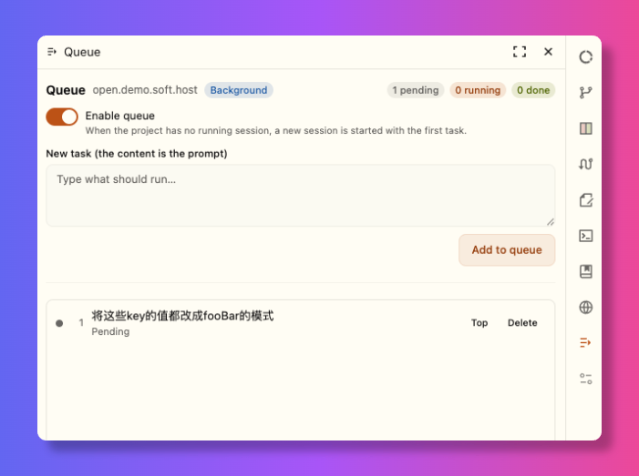

<div align="center">

# OpenChamber Queue

**A per-project task queue for [OpenChamber](https://openchamber.dev).**
Add tasks, flip the queue on, and the next task starts on its own once the
project has been idle for the queue's wait — 30 seconds by default, adjustable
per project — one task at a time, no clicks per task.

English · [简体中文](./README.zh-CN.md)

[](./LICENSE)
[](https://openchamber.dev)
[](#languages)



</div>

A task is **the content** — the prompt — plus the images attached to it. Model,
agent and variant come from the project's own defaults. A task starts once that
project has been idle for the queue's wait (30 seconds by default), so the rail
stays quiet until there is work to do.

> Built as an OpenChamber **extension** (panel + local service), not an OpenCode plugin.

## Contents

- [Features](#features)
- [How it works](#how-it-works) · [Dispatch rules](#dispatch-rules) · [Background service](#background-service)
- [Install](#install)
- [Usage](#usage)
- [Storage and persistence](#storage-and-persistence)
- [Permissions](#permissions)
- [Limitations](#limitations)
- [Development](#development)
- [Languages](#languages)
- [License](#license)

## Features

- **One queue per project** — switching projects switches queues.
- **Images travel with the task** — attach a screenshot by pasting it, dropping
  it on the panel or picking it with **Add image**; the task carries it and the
  dispatched session receives it as an image on its first prompt.
- **Automatic dispatch** — a new session is created and the prompt sent once the
  project has been idle for the queue's wait (30 seconds by default); no clicks
  per task.
- **Dispatch settings, per project** — the idle wait and the longer wait after a
  question are set in seconds, and so are the conditions that count as busy: a
  session asking a question, waiting for permission or running a background
  command, and other sessions in the project. The panel keeps the values in
  `state.json` with the queue.
- **Run now** — a second button sends the draft into a fresh session at once,
  without queueing it.
- **Append to the current session** — a third button queues the draft against the
  session open in the panel, recording its id, and the queue sends the prompt to
  that session when the project is idle instead of creating a new one.
- **Run a queued task now** — each row has a *Run* button that starts that
  task's session immediately and removes it from the queue, counting it in *Done*.
- **Per-task switch** — each row has an *Enabled* checkbox at the end of its
  actions. A task switched off keeps its place in the queue but the scheduler
  passes over it; *Run* still starts it by hand. The *New task* line carries the
  same switch for tasks you are about to add: whatever it is set to is how they
  come out, and you can still flip any one of them afterwards.
- **Three-line summary** — every task shows its content as a short summary of up
  to three lines, line breaks and all, so a longer prompt is readable without
  opening the editor.
- **Runaway protection** — a turn whose session ends with outcome `failed`, or a
  dispatch that cannot create a session, counts as a failure; a few in a row pause
  the queue before more tasks are spent.
- **Hand-off queue** — a task is removed and counted in *Done* the moment its
  session is created; a failed turn does not put it back. An empty queue turns its
  own switch off.
- **Questions don't block** — a session waiting on a question does not hold the
  project: the next task is dispatched, but only after a longer 5-minute window
  that leaves you room to answer first.
- **Editable while stopped** — click a task card to edit it in place; edits are
  refused while the queue is running.
- **Works with the page closed** — the queue is driven by a server-side local
  service, not by the browser tab.
- **Keystrokes aren't lost** — the composer is kept per project as a draft
  (images included) and written to the local service, so a reload, an OpenChamber
  restart or a hard exit restores what you were typing; a background queue change
  never wipes a half-typed task.
- **Localized panel** — follows the OpenChamber language (English, 简体中文, 繁體中文).

## How it works

### Dispatch rules

For each project, every tick:

1. Queue disabled, or empty → nothing to do.
2. The session this queue started is still **executing** → wait.
3. Any **other** session in the project is really executing → wait.
4. The project must then stay free for the queue's **idle wait** — 30 seconds by
   default, and the panel's dispatch settings change it per project. Anything
   that wakes up inside that window — a session you start, a retry on the
   session that just finished — resets the count, so the project has a moment to
   settle. When the run that just ended was **waiting on a question**, the window
   is the queue's **question wait** instead, 5 minutes by default, giving you
   time to answer before the next task starts.
5. Take the first pending task that is **still enabled** → create a session →
   send the content. A task switched off keeps its place and is passed over, so
   the enabled task behind it runs instead. The task leaves the queue and is
   counted in *Done* right away. The window starts over before the task after it.
6. When that session stops executing (idle, gone, or asking a question) the
   project is free again and the window restarts. When the queue empties, the
   switch turns itself off.

The window applies to the first task too: turning the switch on with a task
waiting starts it one idle wait later, not instantly.

A task without images is one call: the control API creates the session and sends
the prompt, which is also what applies the project's default model. A task
**with** images cannot go through it (that call takes text only), so the session
is created first, the project's default model and agent are switched onto it, and
the prompt then goes out on the session's own route with one file part per image,
carrying the bytes as a data URL — the same path the app's own composer uses.
An **append** task skips session creation altogether: the prompt (with the same
route when it carries images) goes to the session id it recorded, which keeps its
own model, agent and history.

"Really executing" means `running`, `retrying` or `waiting-permission`.
`waiting-question` is **not** considered occupied by default, so an agent that is
asking a question never blocks the queue — its task is already handed off, and
the next one simply waits out the longer question window — while a session
you started yourself does make the queue wait its turn.

A run that leaves work running in the background is not finished yet: a session
that sent a command to the background reports idle while the command runs, and
the queue waits for it. A background subagent is a child session, and the parent
goes idle the moment it is launched, so the queue follows the child (at any
depth) until it really finishes instead of calling the run done. A background
command is different: OpenCode keeps no record of what it is for, so an
hour-long test and a forgotten server look alike, and the wait is bounded —
after **Background command wait limit** (2 hours by default, per project; 0
keeps waiting) the pause counts as idle. The session stays watched either way,
so if the command exits later and wakes it, the project is busy again.

The dispatch settings turn those defaults into per-project choices. Under
**A session holds the queue while it is**, *Waiting on a question* is off and the
other three are on. Switching *Waiting on a question* on keeps the run active
until you answer, instead of handing the floor to the next task after the longer
window; switching *Waiting for permission* or *Running a background command* off
treats that pause as idle; and switching *Another session is active* off lets the
queue run even while you work in the same project by hand. `running` and
`retrying` always hold the queue.

### Runaway protection

Handing a task to a session is not proof that the turn succeeded. A provider that
is down, out of quota or misconfigured ends the turn with a failed status, and
without a guard the ordinary settle window would then walk the whole queue,
consuming one task per failed attempt.

OpenCode writes one `idle` record at the end of every turn with an `outcome`:
`succeeded`, `failed` with the provider error, or `interrupted` for a manual stop
or an OpenCode restart. After the run's session frees, the queue reads that
record through the same proxied session routes as the prompt and classifies the
turn:

- **succeeded** — a healthy turn; it also clears the consecutive-failure count.
- **failed** — a real request failure (`provider.transport: Timed out …`, auth,
  quota, an unknown model). It is counted and its error is kept for the panel.
- **interrupted** — neither a success nor a failure; the count is left alone.

After **2 consecutive failures** (the default, per project), the queue switches
itself off and leaves the remaining tasks untouched. The panel shows a banner
with the last error and a **Resume now** action; the queue only starts again when
you resume it, so a broken provider cannot consume the list while you are away.
A dispatch that cannot create the session or send the prompt counts the same
way; that task stays in the queue as *failed*.

A failed turn's task is not put back: it left the queue when it was handed off,
and the queue keeps no copy of the prompt to retry. Open the session in
OpenChamber for its history. Set the limit to 0 to turn the breaker off.

A normal answer that happens to be quick is `succeeded`, so it is not treated as
a failure. A tool call that exits non-zero is part of a turn, not a failed turn,
and does not count either.

### Background service

The queue is owned by a Node process the host starts for
`contributes.service`. It talks to the local OpenChamber control API — the same
route the bundled `openchamber` CLI uses — to read session state, create sessions
and send prompts, and it keeps running with no panel or window open.

The panel is only a view onto that service. It does **not** keep a second,
panel-owned copy of the queue; when the service is not up yet the panel shows a
connecting state and retries until it answers. Because of that, a task added
while the service is starting is never written to a store the service cannot
see — it either reaches the service or the panel says it is still connecting.

The local service must be approved at install time. The queue does not work
without it; approving it is what lets the queue keep running in the background.

## Install

OpenChamber **2.0.0 or newer**, web or desktop.

1. **Settings → Extensions**.
2. Paste one of these into **folder, ZIP or URL** and press **Add**:
   - the latest packaged zip — this URL always points at the newest build:
     `https://github.com/open-tecmz/openchamber-queue/releases/latest/download/openchamber-queue-latest.zip`
   - the `.zip` file from the latest **Releases** page,
   - the `dist/` folder of a local clone (run `npm run build` once first),
   - the git URL of the `release` branch —
     `https://github.com/open-tecmz/openchamber-queue.git#release`
     (git installs can **Update** from Settings → Extensions when `package.json`
     version increases; a zip install cannot, so re-add the newer zip by hand).
3. Approve the permission dialog (**Allow and enable**). It lists `prompt`,
   `sessions` and `service`; the local service runs with your full user rights.

## Usage

Open the **Queue** panel from the extensions area of the rail:

1. Type a task in the box → **Run now** to start a session immediately,
   **Add to queue** to line it up, or **Append to session** to queue it for the
   session that is open right now.
2. Optionally attach up to four images: paste a screenshot into the box, drop
   files on the panel, or press **Add image**. They travel with the task and are
   sent as images on the session's first prompt. A task needs text; the images
   ride along with it.
3. Turn on **Enable queue**.
4. Leave it alone. Once the project has been idle for the queue's wait (30
   seconds by default), the first task runs; when it finishes the next one
   starts.

The header shows the mode and two counters on the right: **pending / done**. Each
row shows the task content as a three-line summary and has *Run*, *Top*, *Retry*
(failed only) and *Delete*, plus an *Enabled* checkbox and how many images the
task carries. *Run* starts that task's session immediately and removes it from
the queue, without waiting for the project to be idle. The *Enabled* checkbox is
that task's own switch for automatic dispatch: uncheck it and the scheduler
skips the task, leaving it in its place — a manual *Run* still works. The *New
task* line has the same checkbox for tasks you are about to add: it decides
whether they start enabled (on by default), so you can queue a batch to review
before any of it runs. With the queue stopped, click a row to expand it into an
editor with **Save** / **Cancel** — there the text can be changed and an image
dropped with the × on its chip.

Other ways to add a task:

- message menu → **Add to queue** (queues the message text);
- composer slash command → `/queue <content>`.

**Dispatch settings** sits under the queue switch as a collapsed line showing the
values in force (`30 s idle · 5 min after a question` by default). Expand it to
set the idle wait and the question wait in seconds, and to choose what counts as
busy: *Waiting on a question*, *Waiting for permission*, *Running a background
command* and *Another session is active*. The same panel holds **Runaway
protection**: *Failures before pausing* (2 by default, per project; 0 turns the
breaker off) and *Background command wait limit* (2 hours by default; 0 waits
for as long as the command runs). Every change is written to the queue's service
in the background: a checkbox applies at once, while a number applies on Enter or
when the field loses focus, so a half-typed number is never stored. A short toast confirms each
save, and a failure shows its reason. The settings are per project and stay in
the queue's `state.json`.

## Storage and persistence

| Data | Location |
| --- | --- |
| Queue state | `~/.config/openchamber-queue/state.json`, or `$OPENCHAMBER_QUEUE_DATA_DIR/state.json` |
| Attached images | `~/.config/openchamber-queue/images/<id>` (with a `<id>.thumb` preview) |
| Diagnostic logs | `~/.config/openchamber-queue/logs/service.log`, or `$OPENCHAMBER_QUEUE_LOG_DIR/service.log` |
| Install record and grants | `<OpenChamber data dir>/extensions.json` |

The queue keeps its own files *beside* the host's data dir — never inside
a project. The host data dir is `~/.config/openchamber`, unless `OPENCHAMBER_DATA_DIR`
is set on the host (a service process does not receive that variable, so a custom
host dir is not mirrored).

An attached image is written once, when it is attached, and the task only stores
its name, type and size — the bytes never enter `state.json`. An image nothing
refers to any more (its task was deleted, its composer was cleared) is removed by
the service's own sweep ten minutes later, so the directory stays bounded.

The service writes what it does to `logs/service.log`, which is the first place to
look when a dispatch or a session did not behave as expected. The active file rolls
over once it reaches 10 MB, keeping five timestamped backups beside it, so the
directory never grows without bound.

Data is a plain JSON file, so it survives restarts, updates and uninstalling. The
composer draft for each project lives in this same file, so a half-typed task is
restored after a reload or a restart. The **worker, however, does not auto-start**:
OpenChamber spawns a guest service only on demand, so after the OpenChamber process
restarts the queue is paused until you open the panel once (or run a message action /
`/queue` command). After that it is resident again. A queue that was enabled resumes
where it left off.

Uninstalling the extension clears its install record and grants; delete
`~/.config/openchamber-queue/` by hand to wipe the queue state too.

## Permissions

| Capability | Why |
| --- | --- |
| `sessions` | list projects and sessions, create sessions |
| `prompt` | send the task content to the new session |
| `service` | the local service that owns the queue; it is required and runs with your full user rights |

The queue has no panel-side fallback: if the local service is not approved, the
panel stays on the connecting state until it is.

## Limitations

- **Cold start** — see *Storage and persistence*: one panel open (or an action) per
  OpenChamber process start is needed to bring the background worker up.
- **Non-public interface** — the service uses the product's own control API and
  proxied OpenCode session routes. These are what the bundled CLI uses, but they are
  not a guest-facing contract and may change between OpenChamber versions.
- **Images** — up to four per task, 5 MB each, and they only help with a model that
  reads images. An image task is created without the control API's own default
  resolution, so the project's default model and agent are read from OpenChamber's
  settings and switched onto the session; with neither configured, OpenCode's own
  default applies.
- **A task counts as done when it is handed off** — the queue sends the prompt but
  cannot tell whether the agent's work produced a useful result. The breaker does
  catch a turn that ends with a failed session status; a turn that completes
  successfully but does the wrong thing is still only visible in the session.
  A failed turn's task is not returned to the queue.
- **The outcome is read from the session's `idle` record** — through the proxied
  session route. If that read fails, the turn is treated as unknown and is not
  counted, so a broken read never pauses the queue by itself.
- **Manifest strings are not localizable** — the extension API takes a fixed panel
  name, command description and action label, so they stay in the declared language
  while the panel itself follows OpenChamber's.
- Extensions do not load in VS Code or the mobile app, so the queue does not either.

## Development

```bash
npm install
npm run build       # assembles the installable package into dist/
npm run typecheck
npm test            # builds, then runs an isolated end-to-end test against a stub
```

`npm run build` writes the whole installable package to `dist/`: `dist/package.json`,
`dist/icon.svg`, `dist/panel/{index,background}.html`, and the two bundles
`dist/panel/main.js` (browser IIFE) + `dist/service/main.js` (Node ESM). The host
loads built `.js` files as they sit in the package, so the pages and their bundles
must stay in the same folder. `dist/` is generated and **not committed**; CI builds
it on every push to `main`.

To run your build while developing, folder-install `dist/` (Settings → Extensions):
it runs from your folder, so edit, rebuild, and reload. `npm test` covers the
headless service.

The host never compiles an extension: ship built files only. Editing `src/i18n.ts`
and rebuilding is enough to add a language. These are the only `devDependencies`;
nothing here ships `node_modules`. Record every change in `changelog.md` before you
finish — the repo rule lives in `AGENTS.md`.

## Languages

The panel follows the OpenChamber language and falls back to English. Panel copy
ships in `en`, `zh-cn` and `zh-tw`; add one by extending `DICTIONARIES` in
`src/i18n.ts` — the dictionary type makes a missing key a compile error. This
documentation ships in English (this file) and 简体中文
([README.zh-CN.md](./README.zh-CN.md)).

## License

[Apache-2.0](./LICENSE).
